# Full-Stack + Applied AI Interview Questions

A question bank for Lead Full-Stack, Applied AI, AI Architect and Forward Deployed Engineer (FDE) interviews. Every section has three parts: **Theory**, **System Design** and **Scenarios**. Each question has a short answer hint, not a full essay. Use the hints to check your own answer, and always back it with an example from a project you built.

> **How to use this file**
> 1. Read the question, answer aloud in 60 to 90 seconds, then compare with the hint.
> 2. For system design, always cover: requirements, components, data flow, failure handling, security, cost and scale.
> 3. For scenarios, answer in this order: contain the damage, find the cause, apply the permanent fix, prevent recurrence.
> 4. Order of the file: AI topics first, then FDE, infrastructure and system topics, and full-stack web last. Inside each topic, System Design comes first.
> 5. Diagrams are in `images/` (PNG) with Mermaid source collapsed under each image. Keep the `images/` folder next to this file.
> 6. Versions of libraries and cloud features change. Verify product details in official docs before an interview.

## Table of contents

1. [Applied AI and LLM Fundamentals (LLM vs SLM)](#1-applied-ai-and-llm-fundamentals-llm-vs-slm)
2. [RAG](#2-rag)
3. [LangChain, LangGraph and Multi-Agent Systems](#3-langchain-langgraph-and-multi-agent-systems)
4. [Tool Calling and MCP](#4-tool-calling-and-mcp)
5. [BMAD and Agentic Development Workflows](#5-bmad-and-agentic-development-workflows)
6. [Evaluation, Guardrails and LLMOps (cross-cutting)](#6-evaluation-guardrails-and-llmops-cross-cutting)
7. [Forward Deployed Engineer (FDE)](#7-forward-deployed-engineer-fde)
8. [Microservices and Distributed Systems](#8-microservices-and-distributed-systems)
9. [Docker and Kubernetes](#9-docker-and-kubernetes)
10. [Multi-Tenant SaaS](#10-multi-tenant-saas)
11. [AWS Lambda and Serverless](#11-aws-lambda-and-serverless)
12. [React and Full-Stack Web](#12-react-and-full-stack-web)
13. [Node.js and NestJS](#13-nodejs-and-nestjs)
14. [Python and FastAPI](#14-python-and-fastapi)
15. [Quick revision checklist](#15-quick-revision-checklist)

---

## 1. Applied AI and LLM Fundamentals (LLM vs SLM)

### System Design

1. **Design a text-to-structured-data extraction service (invoices, forms).**
   Hints: OCR or document parser, LLM with schema, validation, confidence scoring, human review queue, evaluation set, versioned prompts.
2. **Design a model-routing layer with an SLM first and an LLM fallback.**
   Hints: classifier or confidence check, cost and latency budgets, fallback rules, evaluation per route, logging for tuning.
3. **Design an on-premise / private LLM deployment for a regulated customer.**
   Hints: self-hosted model on GPU (vLLM), network isolation, access control, audit logs, PII masking, monitoring, update process.

#### Diagram: LLM gateway with caching and model routing

Mermaid source (renders natively on GitHub)

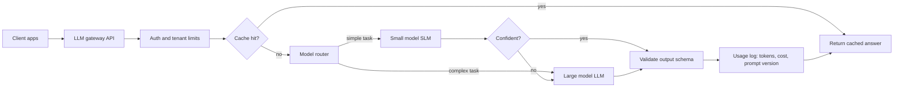

### Theory

1. **What are tokens and why do they matter?**
   Text is split into tokens; cost, latency and context limits are measured in tokens. Count both input and output.
2. **Context window and "lost in the middle".**
   The context window is the total input plus output limit. Models can use information in the middle of long contexts less reliably; put key facts near the start or end and retrieve selectively.
3. **Temperature, top-p, max tokens.**
   Temperature and top-p control randomness. Use low values for extraction and tool calling. Max tokens caps output.
4. **Prompting vs RAG vs fine-tuning: how do you choose?**
   Prompting for behavior and format. RAG for fresh or private knowledge. Fine-tuning for consistent style, format or narrow skill when prompting is not enough. Combine them when needed.
5. **What causes hallucination and how do you reduce it?**
   Missing knowledge and pressure to answer. Ground answers in retrieved sources, require citations, allow "I don't know", validate outputs, and use evaluations.
6. **What is an embedding and what is it good for?**
   A vector representing meaning, used for semantic search, clustering and deduplication. Same-model embeddings must be used for index and query.
7. **SLM vs LLM: when do you use a small language model?**
   SLM: lower cost and latency, on-device or private deployment, narrow tasks (classification, extraction, routing). LLM: broad reasoning, complex instructions, open-ended tasks.
8. **How do you make a small model good at a task?**
   Fine-tuning (LoRA or QLoRA), distillation from a larger model, good task-specific data, quantization for speed and memory, and evaluation on a held-out set.
9. **What is quantization?**
   Storing weights in lower precision (for example 4-bit) to cut memory and increase speed at a small quality cost.
10. **What is LoRA?**
    A parameter-efficient fine-tuning method that trains small adapter matrices instead of all weights.
11. **Structured output.**
    Use JSON schema mode or tool schemas, validate with Pydantic or Zod, retry with the error, fall back if still invalid.
12. **Prompt design for production.**
    Clear role and rules, separate instructions from data, examples, output schema, versioned prompts with tests.
13. **Model routing and caching.**
    Route simple tasks to a smaller model; cache repeated prompts and answers; use prompt caching for long shared prefixes.
14. **Streaming responses.**
    Improves perceived latency; handle partial output and cancellations.
15. **Multimodal input.**
    Images, PDFs and audio; extract text with OCR or speech-to-text when precision matters, and validate results.
16. **Speech-to-text with diarization.**
    Separates speakers so you can attribute statements correctly; accuracy drops with noise and overlapping speech.
17. **Safety basics.**
    Prompt injection, data leakage, harmful output; defend with input and output filters, least-privilege tools and human approval for risky actions.

### Scenarios

1. **Model quality dropped after a provider updated the model.**
   Pin model versions, run the regression set, compare outputs, adjust prompts, and add canary testing for upgrades.
2. **Costs are too high.**
   Measure tokens per feature, shorten prompts, cache, route to smaller models, limit output, batch where possible.
3. **A user finds a way to make the bot ignore rules.**
   Contain, add input and output guardrails, harden the system prompt, restrict tools, add the case to the red-team set.
4. **Latency is 12 seconds per answer.**
   Trace the steps; reduce retrieval size, parallelize calls, use a faster model, stream output, cache.

---

## 2. RAG

### System Design

1. **Design an enterprise RAG assistant with role-based answers on Azure.**
   Hints: ingestion to Blob and AI Search with metadata, hybrid retrieval with role filters, agent loop, Azure OpenAI, citations, fallback to a support ticket, tracing, evaluation gate.
2. **Design RAG for 10 million documents across many tenants.**
   Hints: tenant-aware index or filters, sharding, async ingestion, caching, reranking budget, cost per tenant, monitoring.
3. **Design a customer-support RAG that escalates to humans.**
   Hints: confidence threshold, escalation with conversation history, feedback capture, new questions added to the knowledge base and the evaluation set.
4. **Design a local-to-cloud migration for a RAG prototype (Ollama, FAISS, nomic-embed to Azure).**
   Hints: swap model endpoint, embeddings and vector store; re-index; re-run the golden set; add auth, secrets, tracing and CI/CD.

#### Diagram: RAG pipeline: ingestion and query

Mermaid source (renders natively on GitHub)

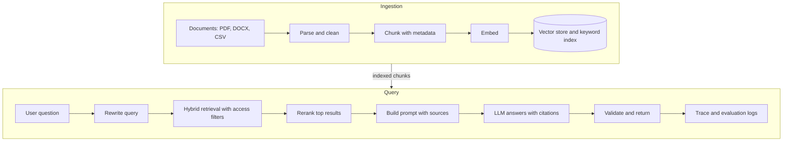

#### Diagram: Enterprise RAG assistant on Azure

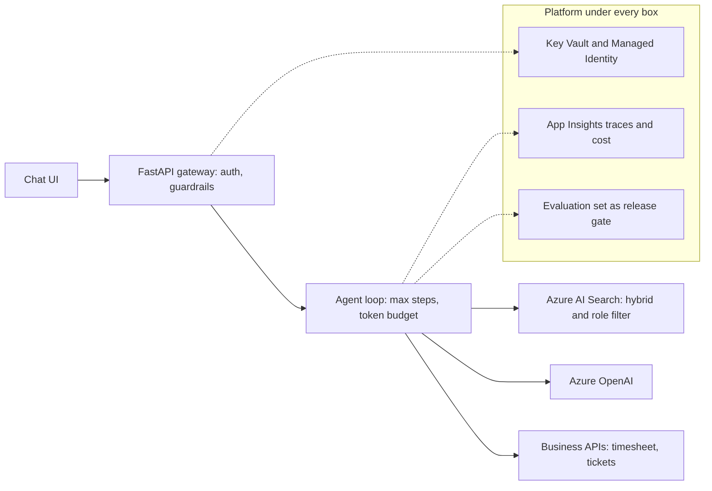

Mermaid source (renders natively on GitHub)

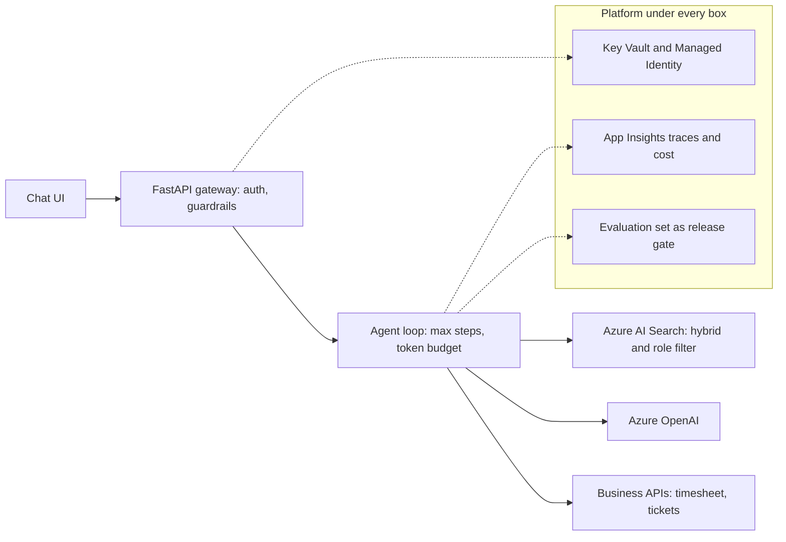

#### Diagram: Local RAG prototype to Azure production

Mermaid source (renders natively on GitHub)

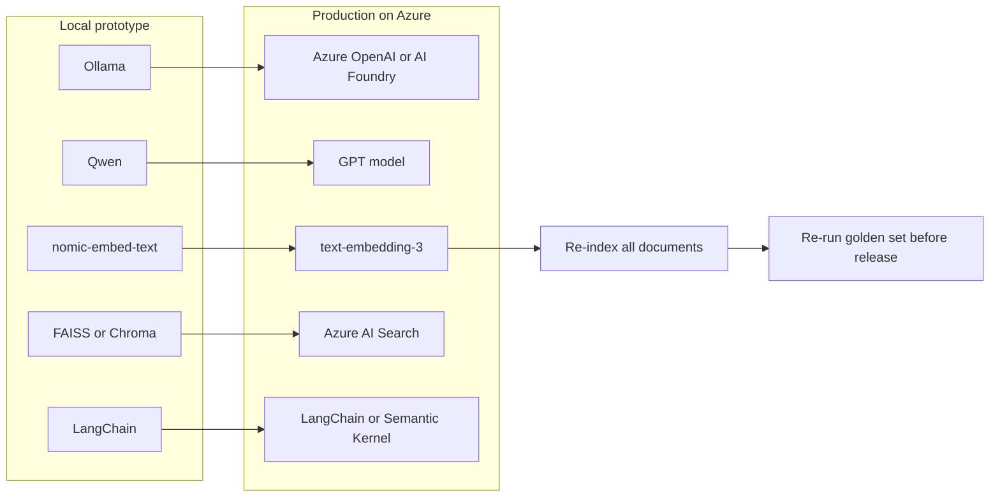

### Theory

1. **Explain a RAG pipeline end to end.**
   Ingest, clean, chunk, embed, store with metadata; at query time rewrite, retrieve, rerank, build the prompt with sources, generate, cite, evaluate.
2. **Chunking strategies.**
   Fixed size with overlap, structure-aware (headings, sections), semantic, parent-child. Choose by document type and test.
3. **Dense vs sparse vs hybrid retrieval.**
   Dense (embeddings) captures meaning; sparse (BM25) captures exact terms; hybrid combines them and usually performs best.
4. **Why use a reranker?**
   A cross-encoder rescores the top candidates more accurately than vector similarity; improves precision.
5. **Metadata filtering and access control.**
   Filter by tenant, role, department and document status before retrieval; never rely on the model to hide restricted content.
6. **Query rewriting, multi-query and HyDE.**
   Rewrite vague questions, generate variants, or create a hypothetical answer to embed. Useful when queries and documents use different language.
7. **Evaluation metrics.**
   Retrieval: recall@k, MRR, nDCG. Generation: faithfulness (grounded), answer relevance, correctness. Tools: RAGAS or custom golden sets.
8. **Handling tables, PDFs and images.**
   Layout-aware parsing, keep tables intact, convert to structured text, OCR for scans, store page references for citations.
9. **Keeping the index fresh.**
   Incremental ingestion with change detection, document versions, deletions, and re-embedding when the embedding model changes.
10. **Vector store choices.**
    FAISS (library, local), Chroma (local/dev), pgvector (Postgres), Azure AI Search / OpenSearch (managed, hybrid and filters), Pinecone and others. Pick by scale, filters, ops and cost.
11. **ANN indexes: HNSW vs IVF.**
    HNSW: high recall and speed, more memory. IVF: clusters, less memory, tunable recall. Quantization reduces storage.
12. **GraphRAG: when is it useful?**
    When answers depend on relationships across entities and multi-hop reasoning (for example drug, target, disease). Costs more to build and maintain than vector RAG.
13. **Agentic RAG.**
    An agent decides when and what to retrieve, may use multiple sources and tools, and checks if the evidence is enough before answering.
14. **Citations and attribution.**
    Return source ids, pages and snippets; verify that quoted text exists in the source.
15. **Common RAG failure modes.**
    Bad chunking, missing metadata, wrong embedding model, retrieval of near-duplicates, prompt overload, outdated data.
16. **Long documents.**
    Hierarchical retrieval (summary first, then details), map-reduce summarization, parent-child retrieval.
17. **Multilingual RAG.**
    Use multilingual embeddings, store language metadata, consider translating queries.

### Scenarios

1. **The bot gives a confident wrong answer.**
   Trace the query: what was retrieved and what went into the prompt; separate retrieval failure from generation failure; fix; add to the golden set.
2. **Retrieval recall is stuck at 70%.**
   Categorize misses; try hybrid search, better chunking, metadata, query rewriting, reranker, domain-tuned embeddings.
3. **Documents are updated daily but answers are stale.**
   Add change detection, incremental re-index, versioning, and a freshness filter.
4. **A restricted HR document appears in another department's answer.**
   Contain, audit, fix the filter placement (before retrieval), add tests for access control, review ingestion metadata.
5. **After switching the embedding model, results got worse.**
   You must re-embed everything; compare on the golden set; check dimension and normalization; tune chunk size for the new model.

---

## 3. LangChain, LangGraph and Multi-Agent Systems

### System Design

1. **Design a multi-agent system that processes insurance documents end to end.**
   Hints: classifier agent, extraction agent, validation/rules agent, reviewer UI, supervisor, exception queue, audit log, evaluation by document type.
2. **Design a research assistant with planner, searcher and writer agents.**
   Hints: planner decomposes, searcher uses tools with source tracking, writer composes with citations, critic verifies, budget and step limits.
3. **Design an agent that checks documentation against a live UI and proposes updates.**
   Hints: login per role, crawl screens, compare with guide text, rank differences by confidence, write drafts only, human approval, Excel/report output.

#### Diagram: Supervisor multi-agent pattern

Mermaid source (renders natively on GitHub)

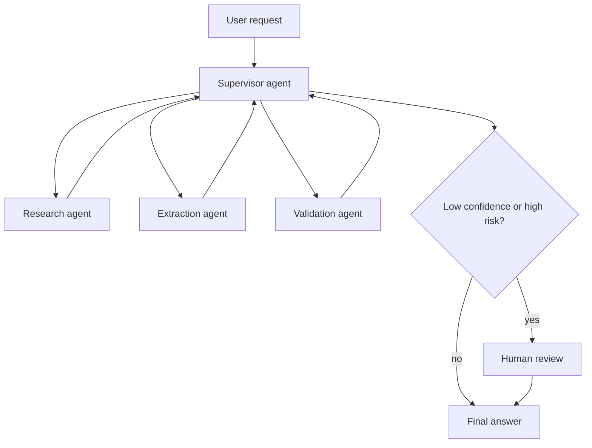

#### Diagram: LangGraph flow with human approval and checkpoints

Mermaid source (renders natively on GitHub)

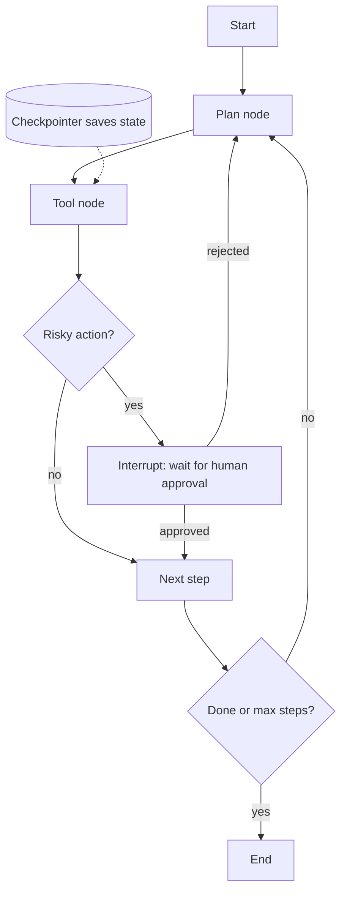

### Theory

1. **What are the core LangChain abstractions?**
   Models, prompts, output parsers, retrievers, tools, runnables and chains (LCEL), memory/state, callbacks.
2. **What is LCEL / the Runnable interface?**
   A composable interface (`invoke`, `stream`, `batch`) that lets you pipe components with consistent behavior.
3. **LangChain vs LangGraph.**
   LangChain composes components into chains; LangGraph models stateful, cyclic workflows as graphs with nodes, edges, checkpoints and human-in-the-loop.
4. **LangGraph concepts.**
   State schema, nodes, conditional edges, reducers, checkpointers for persistence and resume, interrupts for human approval, subgraphs.
5. **Multi-agent patterns.**
   Supervisor/orchestrator, sequential pipeline, hierarchical teams, handoffs/swarm, debate or critic-reviewer.
6. **When should you not use multi-agent?**
   When one agent with good tools works. Multi-agent adds cost, latency and failure modes.
7. **How do agents share state and memory?**
   Shared graph state for the run, scoped messages per agent, short-term memory (conversation), long-term memory (database or vector store).
8. **How do you prevent infinite loops and runaway cost?**
   Max steps, timeouts, token budgets, stop conditions, and budget alerts.
9. **Handoff design.**
   Clear contracts: what the receiving agent gets (task, context, constraints) and what it must return.
10. **Conflict between agents.**
    Use a supervisor with a decision rule, a verifier agent, or human review for high-risk decisions.
11. **Memory types and risks.**
    Summaries can drop facts; stored memories can leak across users; scope memory by user and tenant.
12. **Observability for agents.**
    Trace every step (LangSmith, OpenTelemetry), log prompts, tool calls, latency, tokens and outcomes.
13. **Testing agents.**
    Unit test tools, scripted scenarios with mocked LLM, evaluation sets for end-to-end behavior, regression checks on trajectories.
14. **Semantic Kernel / Microsoft Agent Framework vs LangGraph.**
    Both orchestrate agents and tools. Semantic Kernel/Agent Framework integrates with the Microsoft ecosystem; LangGraph is Python/JS-first with strong graph state control. The concepts transfer.
15. **Durable workflows for agents.**
    Temporal, Durable Functions or Trigger.dev provide retries, state and replay for long-running processes.

### Scenarios

1. **The agent loops and spends $200 in an hour.**
   Kill switch, step and token limits, budget alerts, add loop detection, analyze the trace to find why it did not stop.
2. **The supervisor picks the wrong sub-agent often.**
   Improve agent descriptions, add examples, a router evaluation set, or replace LLM routing with rules for clear cases.
3. **Two agents give contradictory answers.**
   Add a verifier with source evidence, define precedence rules, escalate to a human when confidence is low.
4. **A tool in the graph fails intermittently.**
   Retry with backoff, circuit breaker, fallback path, surface failure to the user, checkpoint so the run can resume.
5. **Stakeholders ask: "Why use agents at all?"**
   Show the task needs multi-step tool use and branching; compare against a simple chain on cost, quality and maintenance.

---

## 4. Tool Calling and MCP

### System Design

1. **Design a Jira tool agent that can search, create and update tickets safely.**
   Hints: read tools open, write tools gated, field allowlist, confirmation step, per-user token, audit log, idempotency key, rollback via stored previous values.
2. **Design an MCP server for internal knowledge and ticketing.**
   Hints: resources for docs, tools for search/create, OAuth per user, rate limits, logging, versioned schemas, deployment as a remote service.
3. **Design a tool layer for an enterprise assistant with 100+ internal APIs.**
   Hints: a registry with metadata, tool retrieval by task, permission model, sandboxing, monitoring of tool success rates.

#### Diagram: Tool calling loop

Mermaid source (renders natively on GitHub)

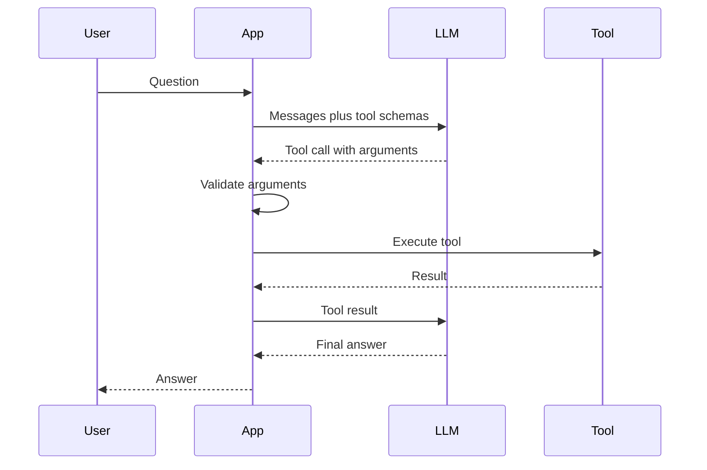

#### Diagram: MCP architecture: host, clients and servers

Mermaid source (renders natively on GitHub)

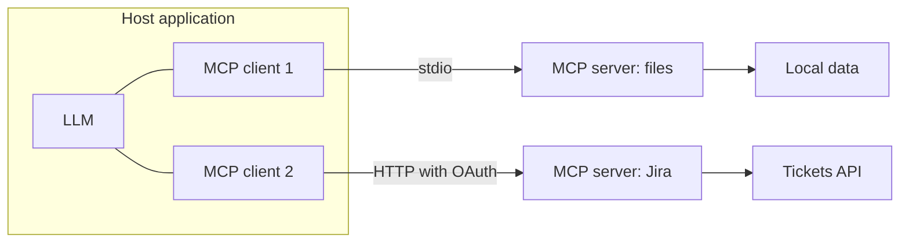

### Theory

1. **How does tool/function calling work?**
   You send tool definitions (name, description, JSON schema). The model returns a structured call. Your code validates arguments, executes, returns the result, and the model continues.
2. **Good tool design.**
   Small clear tools, precise descriptions, strict schemas, enums, helpful error messages, idempotent where possible.
3. **How do you handle invalid arguments?**
   Validate with Pydantic/Zod, return the validation error to the model, allow limited retries, then fail gracefully.
4. **Parallel tool calls and tool chaining.**
   Models can request multiple independent calls at once; chain when later calls depend on earlier results.
5. **Too many tools in context.**
   Large tool lists waste tokens and confuse selection. Use tool search/routing, group by task, or load tools on demand.
6. **Destructive tools and approvals.**
   Read-only by default; require confirmation for writes and deletes; log everything.
7. **What is MCP (Model Context Protocol)?**
   An open protocol that standardizes how AI applications connect to tools and data. Host (the app) runs MCP clients that talk to MCP servers.
8. **MCP primitives.**
   Tools (actions), resources (data), prompts (templates). Transports include stdio for local servers and HTTP-based transport for remote servers.
9. **MCP vs direct function calling.**
   Function calling is how a model asks for an action. MCP standardizes how tools are discovered and served across many apps. Use MCP for reuse, discovery and central auth; use direct integration for a single app with stable needs.
10. **MCP security concerns.**
    Prompt injection through tool outputs, malicious or poisoned tool descriptions, over-broad permissions, token passthrough and confused-deputy problems. Use least privilege, per-user OAuth, allowlists and review of third-party servers.
11. **Authentication for remote MCP servers.**
    OAuth-based authorization with scoped tokens and per-user identity; avoid long-lived shared keys.
12. **Auditability.**
    Log each tool call with user, arguments, result summary and approval status.
13. **When would you build an MCP server?**
    When internal systems (tickets, CRM, docs) must be exposed safely to several agents and clients with consistent auth and logging.
14. **Idempotency and retries for tools.**
    Use idempotency keys for writes so retries do not duplicate actions.
15. **Testing tools.**
    Unit tests for tool logic, contract tests for schemas, and scenario tests that check the model chooses the right tool.

### Scenarios

1. **The model calls the wrong tool or invents arguments.**
   Improve names and descriptions, add examples, reduce overlapping tools, validate strictly, evaluate tool selection.
2. **A retrieved web page contains instructions to export customer data.**
   Treat tool output as untrusted, strip or flag instructions, require approval for sensitive actions, restrict outbound data tools.
3. **The agent updated the wrong Jira ticket.**
   Disable write tools, use the audit log to see what happened, restore previous values, add confirmation and field-level guards.
4. **A third-party MCP server changed its tool description after approval.**
   Pin versions, hash tool definitions, alert on changes, re-review before use.
5. **Tool calls are slow and users wait.**
   Parallelize independent calls, cache read results, stream partial updates, move slow work to async jobs.

---

## 5. BMAD and Agentic Development Workflows

> **Note:** BMAD (the BMad Method, "Breakthrough Method for Agile AI-Driven Development") is a spec-driven workflow that uses role-based agent personas (for example analyst, product manager, architect, scrum master, developer, QA) and written artifacts (PRD, architecture, stories) to guide AI-assisted development. Verify the current version and agent list in its repository before an interview.

### System Design

1. **Design a Claude Code scaffolding agent that adds a feature across backend and frontend repos.**
   Hints: skills that encode conventions, templates per layer, reads existing modules, generates API, service, UI and tests, runs linters and tests, opens a PR for human review.
2. **Design an internal developer platform that standardizes AI tooling for a 10-person team.**
   Hints: shared `CLAUDE.md`/conventions, skills library, MCP servers for internal systems, review checklist, usage and cost visibility, onboarding guide.
3. **Design an automated code-modernization pipeline (for example a framework or language migration across many repos).**
   Hints: codemod and extension to scan, agent to propose changes, tests as the gate, batch PRs, rollback plan, tracking dashboard.

#### Diagram: BMAD workflow with human gates

Mermaid source (renders natively on GitHub)

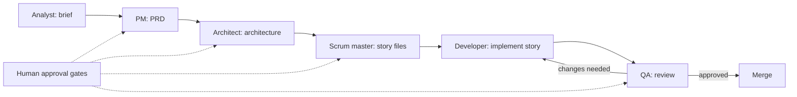

### Theory

1. **What problem does BMAD solve?**
   Unstructured AI coding drifts and loses context. BMAD adds planning artifacts and role-specific agents so each step has clear inputs, outputs and review points.
2. **Explain the BMAD agent roles.**
   Analyst/PM create the brief and PRD, Architect designs the system, Scrum Master/PO breaks work into detailed stories, Developer implements a story, QA reviews. Humans approve between phases.
3. **Why write specs before code?**
   Specs give the AI stable context, reduce rework, and make reviews easier because intent is explicit.
4. **What is context sharding in this workflow?**
   Splitting large documents (PRD, architecture) into smaller pieces so each agent loads only what it needs, saving tokens and reducing confusion.
5. **How does a story file help the developer agent?**
   It contains the task, acceptance criteria, relevant architecture notes and test expectations, so the agent works with focused context.
6. **How does this compare with Claude Code skills and `CLAUDE.md`?**
   BMAD defines an end-to-end process and personas; Claude Code skills and `CLAUDE.md` capture reusable instructions and project conventions inside the tool. They can be combined.
7. **What are SKILL.md-style skills good for?**
   Packaging repeatable procedures (scaffolding a feature, writing tests, following conventions) with instructions, templates and scripts that the agent loads when relevant.
8. **How do you keep AI-generated code consistent with an existing codebase?**
   Provide conventions, example files, lint rules, templates, and tests; have the agent read similar existing modules first; review diffs.
9. **How do you review agent-written code?**
   Treat it like a junior's PR: read the diff, run tests, check edge cases and security, verify against acceptance criteria.
10. **What are the risks of agentic coding?**
    Hallucinated APIs, hidden security bugs, over-engineering, large unreviewed diffs, secrets leakage, and skill atrophy.
11. **Brownfield vs greenfield with BMAD.**
    Greenfield fits the full flow. For existing code, first document the architecture and conventions (reverse-engineering docs), then work in small stories.
12. **How do you measure the value of agentic development?**
    Lead time per story, rework rate, defects found after merge, test coverage, and developer satisfaction, compared with a baseline.
13. **Where does this process fail?**
    Vague requirements, stale documents, huge stories, no human review gates, or teams treating the output as final.

### Scenarios

1. **The developer agent keeps implementing things not in the story.**
   Tighten acceptance criteria and scope in the story, add "do not" rules, shrink context, and review early.
2. **Generated code passes tests but violates architecture rules.**
   Add architecture lint rules or tests, a checklist agent in review, and update the conventions file.
3. **Team members use AI inconsistently and quality varies.**
   Create shared conventions and skills, a PR template with AI-use notes, training sessions, and measure results.
4. **A planning document is outdated and agents follow it.**
   Make updating specs part of "done", version documents, and have the architect agent re-validate before new epics.
5. **Leadership asks whether AI-driven development is worth the cost.**
   Present measured baselines and results, show token cost vs engineering time saved, and state limitations honestly.

---

## 6. Evaluation, Guardrails and LLMOps (cross-cutting)

### System Design

1. **Design an observability stack for an LLM application.**
   Hints: traces with prompt, retrieved context and tool calls, token and cost metrics per tenant, dashboards, alerts, sampled human review.
2. **Design a continuous evaluation pipeline.**
   Hints: golden set in CI, nightly runs on production-like data, regression thresholds, failure reports, feedback loop from production.

#### Diagram: Continuous evaluation and release gate

Mermaid source (renders natively on GitHub)

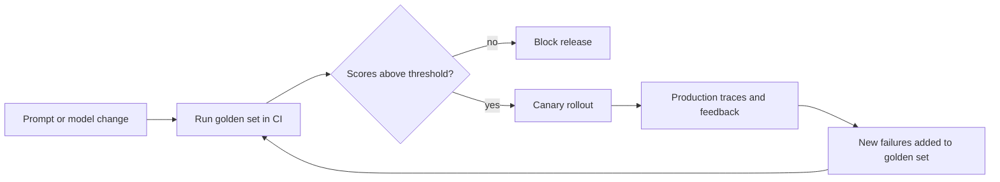

### Theory

1. **How do you build a golden dataset?**
   Collect real questions, label expected sources and answers, include hard and adversarial cases, version the set and grow it from production failures.
2. **LLM-as-judge: strengths and limits.**
   Scales evaluation but can be biased and inconsistent. Use a clear rubric, calibrate against human labels, and keep spot checks.
3. **What do you monitor in production?**
   Latency, token usage and cost, error and fallback rates, retrieval quality signals, user feedback, escalations, safety flags.
4. **Prompt and model versioning.**
   Store prompts in version control, tag each run with prompt and model versions, roll out through canary and release gates.
5. **Guardrails layers.**
   Input checks (PII, injection patterns), retrieval/tool permissions, output validation (schema, policy), and human approval for high-risk actions.
6. **PII handling.**
   Detect and mask before sending to external models, restrict logs, set retention, and respect residency requirements.
7. **Failure taxonomy.**
   Classify failures (retrieval miss, wrong tool, bad format, policy violation, latency) to prioritize fixes.
8. **Release gates for higher-risk automations.**
   Minimum scores on the evaluation set, red-team review, approval workflow, staged rollout.
9. **Data flywheel.**
   Capture human edits and feedback as labeled data, feed into evaluations and tuning, and track improvement over time.
10. **Governance in regulated settings.**
    Audit trails, explainability of sources, access control, change management, and documented risk assessment.

### Scenarios

1. **A prompt change improved one case but broke others.**
   Run the full regression set before merge, compare per-category scores, and use the release gate.
2. **A regulator or auditor asks why the system gave an answer.**
   Show the trace: question, retrieved sources, prompt version, model version, tool calls, and reviewer actions.
3. **Costs doubled after a new feature launched.**
   Per-feature token dashboards, find long prompts or loops, add caching and routing, and set budgets.

---

## 7. Forward Deployed Engineer (FDE)

### System Design

1. **Design an AI support agent for a customer's e-commerce operation.**
   Hints: ingest manuals and policies into a vector store, channels (WhatsApp, email), tool calls to order systems, escalation to human with history, evaluation set from real tickets, dashboards.
2. **Design a document-extraction solution for an insurance or logistics customer.**
   Hints: document classification, extraction with confidence scores, rules checks, exception queue for human review, audit log, feedback loop to improve accuracy.
3. **Design a lead-intelligence workflow from calls and chats.**
   Hints: capture, transcription with diarization, summarization with grounding, scoring, CRM sync, follow-up automation, human review of low-confidence output.

#### Diagram: FDE engagement lifecycle

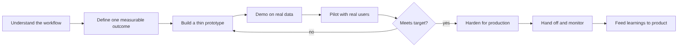

Mermaid source (renders natively on GitHub)

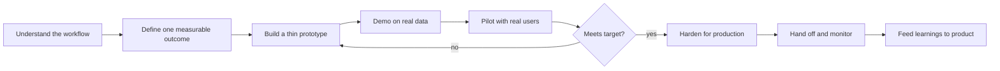

#### Diagram: Document extraction with human review

Mermaid source (renders natively on GitHub)

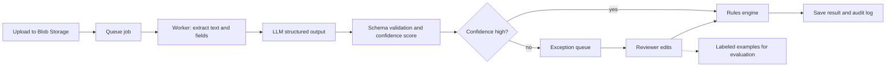

### Theory

1. **What does an FDE do compared with a standard software engineer?**
   Embeds with customers, turns ambiguous business problems into working solutions quickly, integrates with their systems and data, and feeds learnings back to the core product.
2. **How do you scope an ambiguous customer problem?**
   Interview users, map the current workflow, define one measurable outcome, agree on a thin vertical slice, and list assumptions and risks.
3. **Prototype vs production trade-offs.**
   Prototype to learn fast and prove value; for production add auth, error handling, monitoring, evaluation and ownership. Be clear with the customer which one they are getting.
4. **How do you handle messy customer data?**
   Profile first, agree on a schema, add validation and a quarantine path for bad records, and report data quality openly.
5. **How do you communicate with non-technical stakeholders?**
   Plain language, outcomes before architecture, demos over slides, written follow-ups with decisions and next steps.
6. **How do you measure success of an AI deployment?**
   Business metric (hours saved, resolution rate) plus quality metrics (accuracy, escalation rate) measured against a baseline.
7. **How do you decide what to build vs what to configure?**
   Use the product or platform where possible; build custom only where the customer need is unique and valuable.
8. **How do you contribute learnings back to the product team?**
   Document patterns, file clear feature requests with evidence, and package reusable components.
9. **Security and compliance on customer sites.**
   Least privilege, data residency, PII handling, audit logs, approvals for access, no data copied to unapproved places.
10. **How do you handle pushback from a skeptical user?**
    Involve them early, show quick wins on their real tasks, keep a human-in-the-loop until trust is built.

### Scenarios

1. **The customer asks for a feature that does not exist and wants it in 2 weeks.**
   Clarify the outcome, offer the smallest version that proves value, state what is out of scope, agree on success criteria, and flag the maintenance cost.
2. **Your demo worked, but the pilot accuracy is 60%.**
   Collect failures from real data, categorize them, fix data and retrieval first, set an accuracy target with the customer and add a human review step meanwhile.
3. **The customer's IT team blocks access to their systems.**
   Work with sanctioned access paths, propose a read-only integration first, document data flow and security controls, escalate through the sponsor.
4. **After go-live, adoption is low.**
   Observe real users, find workflow friction, simplify, train champions, and track usage metrics.
5. **The customer wants to send sensitive data to a public LLM.**
   Explain risks, offer private deployment or masking, get written approval, and use an enterprise-grade endpoint with no training on their data.

---

## 8. Microservices and Distributed Systems

### System Design

1. **Design an order system for a multi-store e-commerce and ERP platform.**
   Hints: catalog, inventory, orders, payments, shipping, notifications as services; reserve stock; saga for payment failure; idempotent payment callbacks; per-store config.
2. **Design a URL shortener / lead-capture endpoint at high scale.**
   Hints: ID generation, key-value store, caching, read-heavy scale, analytics via async events.
3. **Design a notification platform with priorities and retries.**
   Hints: priority queues, per-channel workers, templates, user preferences, throttling, dead-letter queue, delivery status tracking.
4. **Design an audit and replayable event history for multi-step AI-assisted processes.**
   Hints: append-only event store, run id, state transitions, prompt and model versions recorded, replay tooling.

#### Diagram: Outbox pattern with saga compensation

Mermaid source (renders natively on GitHub)

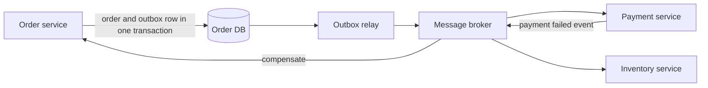

### Theory

1. **Monolith vs microservices: when to split?**
   Split when teams, scaling needs or release cycles diverge. Start modular monolith if the domain is not clear. Microservices add network, data and operational cost.
2. **Synchronous vs asynchronous communication.**
   Sync (REST, gRPC) is simple but couples availability. Async (queues, events) decouples and absorbs spikes but adds eventual consistency.
3. **API gateway responsibilities.**
   Routing, auth, rate limiting, request shaping, observability. Avoid putting business logic there.
4. **Database per service and how to share data.**
   Each service owns its data. Share through APIs or events, not shared tables.
5. **Saga pattern.**
   A sequence of local transactions with compensating actions. Choreography (events) or orchestration (a coordinator).
6. **Outbox pattern.**
   Write the business change and an event row in one transaction; a relay publishes the event, avoiding lost or phantom events.
7. **Idempotency.**
   Making repeated requests safe, usually with idempotency keys and unique constraints.
8. **Circuit breaker, retry, timeout, bulkhead.**
   Fail fast on unhealthy dependencies, retry with backoff and jitter, limit resource use per dependency.
9. **CAP theorem and eventual consistency.**
   During a partition you choose consistency or availability. Most microservices accept eventual consistency with clear user experience.
10. **Service discovery and load balancing.**
    DNS or a registry; in Kubernetes, Services and Ingress.
11. **Distributed tracing and observability.**
    Correlation IDs, OpenTelemetry traces, structured logs, metrics (RED/USE), alerts based on SLOs.
12. **API versioning and backward compatibility.**
    Additive changes, versioned routes or headers, deprecation windows, consumer-driven contract tests.
13. **CQRS and event sourcing.**
    Separate read and write models; event sourcing stores state as events. Powerful but complex; use where audit and replay matter.
14. **Message delivery guarantees.**
    At-most-once, at-least-once (needs idempotent consumers), exactly-once (usually effectively-once through idempotency).

### Scenarios

1. **One slow downstream service takes down the whole system.**
   Add timeouts, circuit breakers, bulkheads, caching and graceful degradation; show partial results.
2. **A message is processed twice and money is charged twice.**
   Idempotency key at the payment layer, deduplicate by message id, make consumers idempotent.
3. **Two services need the same data and teams keep breaking each other.**
   Define ownership, publish events or APIs, add contract tests and versioning.
4. **A schema change breaks a consumer in production.**
   Roll back or hotfix, use expand-and-contract migration (add, dual write, switch, remove), and contract tests.

---

## 9. Docker and Kubernetes

### System Design

1. **Design a CI/CD pipeline for 10 microservices to Kubernetes.**
   Hints: build and test, image scan, push to registry, deploy via Helm/GitOps, environments, canary and rollback, secrets management.
2. **Design a deployment for a Python AI service with spiky load.**
   Hints: stateless containers, HPA/KEDA on queue depth, resource requests for memory-heavy models, model loading at startup, readiness only after model is loaded.
3. **Design multi-environment (dev, staging, prod) with isolation.**
   Hints: separate namespaces or clusters, config per environment, promotion by image tag, access control.

#### Diagram: CI/CD to Kubernetes with autoscaling

Mermaid source (renders natively on GitHub)

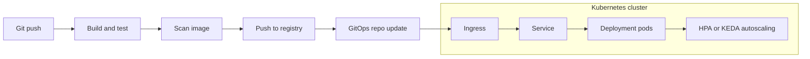

### Theory (Docker)

1. **Image vs container.**
   An image is a read-only layered template; a container is a running instance with a writable layer.
2. **How do layers and caching work?**
   Each instruction creates a layer; order instructions from least to most frequently changed (install dependencies before copying source).
3. **Multi-stage builds.**
   Build in one stage, copy only artifacts into a small runtime image. Smaller and safer.
4. **`CMD` vs `ENTRYPOINT`; `COPY` vs `ADD`.**
   `ENTRYPOINT` is the fixed executable, `CMD` supplies default arguments. Prefer `COPY`; `ADD` also extracts archives and fetches URLs.
5. **Volumes vs bind mounts; networking modes.**
   Volumes are managed persistent storage; bind mounts map host paths. Bridge, host and overlay networks.
6. **Container security basics.**
   Run as non-root, minimal base image (slim or distroless), scan images, no secrets in layers, read-only filesystem where possible.
7. **Health checks and graceful shutdown.**
   Define `HEALTHCHECK`; handle `SIGTERM` so in-flight requests finish.

### Theory (Kubernetes)

8. **Pod, Deployment, StatefulSet, DaemonSet, Job.**
   Pod: smallest unit. Deployment: stateless replicas with rolling updates. StatefulSet: stable identity and storage. DaemonSet: one per node. Job: run to completion.
9. **Service types.**
   ClusterIP (internal), NodePort, LoadBalancer (cloud), plus Ingress for HTTP routing.
10. **ConfigMap vs Secret.**
    Config vs sensitive data. Secrets are base64-encoded, not encrypted by default; use encryption at rest, external secret stores and RBAC.
11. **Requests vs limits.**
    Requests are used for scheduling; limits cap usage. CPU over limit is throttled, memory over limit is OOM-killed.
12. **Probes.**
    Liveness restarts a stuck container, readiness controls traffic, startup protects slow starts.
13. **Autoscaling.**
    HPA scales pods on metrics (CPU, custom); KEDA scales on queue length; Cluster Autoscaler adds nodes; VPA adjusts requests.
14. **Rolling update, rollback, blue-green, canary.**
    Rolling is the default; `kubectl rollout undo` to roll back; canary shifts a small share of traffic first.
15. **Namespaces, RBAC, network policies.**
    Isolation, least-privilege access, and restricting pod-to-pod traffic.
16. **Helm and GitOps.**
    Helm packages manifests; GitOps tools (Argo CD, Flux) sync cluster state from Git.

### Scenarios

1. **Pod is in `CrashLoopBackOff`.**
   `kubectl describe` and `logs --previous`; check config, missing secret, failing probe, wrong command, resource limits.
2. **Pod is `OOMKilled`.**
   Check memory usage, leaks, limits too low, model or cache size; adjust limits and fix the leak.
3. **Deployment succeeded but users get 502 errors.**
   Readiness probe wrong, service selector mismatch, port mismatch, ingress config; check endpoints.
4. **A node fails during peak traffic.**
   Replicas across nodes and zones, pod disruption budgets, anti-affinity, autoscaling headroom.
5. **Image builds are slow and huge.**
   Multi-stage build, `.dockerignore`, cache dependencies, smaller base image.

---

## 10. Multi-Tenant SaaS

### System Design

1. **Design a multi-tenant SaaS for lead management with client-scoped data.**
   Hints: tenant id, RLS, roles, per-tenant integrations (WhatsApp, CRM), usage events, dashboards scoped by tenant.
2. **Design cost attribution for AI usage across tenants.**
   Hints: `usage_events` table (tenant, run id, model, tokens, cost, time), tag every LLM and external call, aggregate for finance, budgets and alerts.
3. **Design onboarding and offboarding of a tenant.**
   Hints: provisioning workflow, idempotent steps, data export, retention, deletion proof, audit.

#### Diagram: Multi-tenant models: pool, bridge and silo

Mermaid source (renders natively on GitHub)

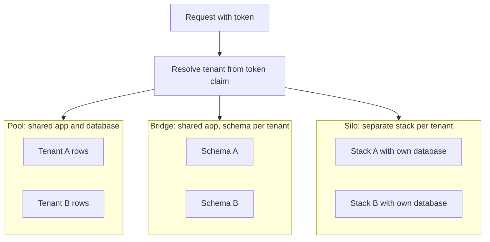

#### Diagram: Tenant isolation, rate limits and cost attribution

Mermaid source (renders natively on GitHub)

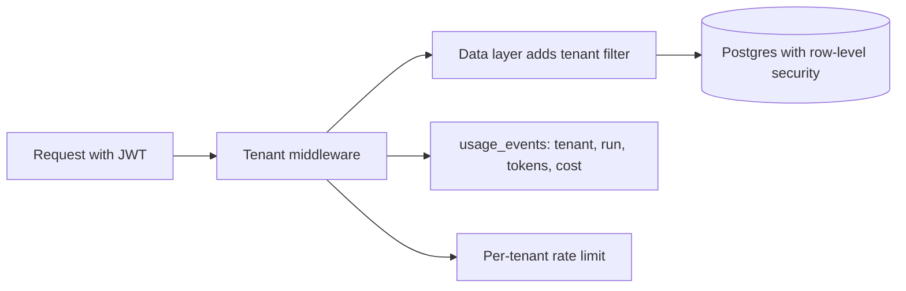

### Theory

1. **Tenancy models.**
   Silo (separate stack or database per tenant), pool (shared everything with tenant id), bridge/hybrid (shared app, separate schema or database).
2. **Trade-offs of each model.**
   Silo: strongest isolation, highest cost and operations. Pool: cheapest, hardest isolation and noisy neighbors. Schema-per-tenant: middle ground, migrations get heavy at scale.
3. **How do you enforce data isolation?**
   Tenant id on every table, enforced in a data-access layer and by Postgres row-level security; tests that try cross-tenant access.
4. **Tenant resolution.**
   From subdomain, JWT claim, or API key; never trust a tenant id sent in the request body.
5. **Noisy neighbor problem.**
   Per-tenant rate limits and quotas, separate queues or worker pools for big tenants, fair scheduling.
6. **Tenant-aware authentication and authorization.**
   Tenant in token claims, role-based or attribute-based access, SSO per tenant (SAML/OIDC).
7. **Self-service onboarding.**
   Automated provisioning: create tenant, defaults, roles, keys, seed data, billing profile.
8. **Per-tenant configuration and feature flags.**
   Config table plus cache; plan-based entitlements.
9. **Usage metering and billing.**
   Record usage events per tenant, aggregate, send to a billing system; useful for AI token and API cost attribution.
10. **Schema migrations at scale.**
    Expand-and-contract, backward-compatible changes, run per-tenant migrations in batches with monitoring.
11. **Encryption, backup and restore per tenant.**
    Per-tenant keys where required; tenant-level restore is easier in silo or schema models.
12. **Compliance and data residency.**
    Region-specific deployments, audit logs, retention and deletion policies.

### Scenarios

1. **A customer sees another customer's data.**
   Contain (disable the path), identify scope from audit logs, notify as required, fix the missing filter, add RLS and automated cross-tenant tests, review all queries.
2. **One tenant's bulk import slows everyone.**
   Move to async queue with per-tenant concurrency limit, rate limit, and a separate worker pool.
3. **An enterprise customer wants its own database and region.**
   Offer a silo or bridge deployment path; make the app tenant-config driven so the same code runs in both modes.
4. **A migration fails halfway for 30 tenants.**
   Make migrations idempotent and resumable, track per-tenant version, roll forward, communicate status.

---

## 11. AWS Lambda and Serverless

### System Design

1. **Design a serverless speech-to-text pipeline for call recordings.**
   Hints: upload to S3, event triggers Lambda, call speech-to-text (diarization), store transcript, queue the AI summarization step, notify, DLQ for failures, idempotent per recording id.
2. **Design a webhook ingestion service that must never lose events.**
   Hints: API Gateway to SQS directly, Lambda consumers, DLQ, idempotency, signature verification, replay tool.
3. **Design a serverless multi-channel capture API (WhatsApp, IVR, social, landing pages).**
   Hints: one normalizing layer per channel, common lead schema, queue, enrichment, storage, real-time updates to the UI.

#### Diagram: Serverless speech-to-text pipeline

Mermaid source (renders natively on GitHub)

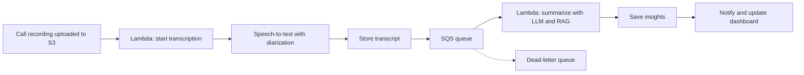

### Theory

1. **What is a cold start and how do you reduce it?**
   First invocation initializes the runtime and code. Reduce with smaller packages, lazy imports, provisioned concurrency, lighter runtimes, avoiding VPC where unneeded.
2. **Lambda concurrency.**
   Account limits, reserved concurrency (guarantee and cap), provisioned concurrency (pre-warmed).
3. **Memory, CPU and timeout.**
   CPU scales with memory; tune memory for cost-speed balance; maximum timeout is 15 minutes.
4. **Event sources and invocation types.**
   API Gateway (sync), S3/SNS (async), SQS/DynamoDB Streams/Kinesis (poll-based event source mapping).
5. **Error handling.**
   Async: retries then DLQ or destinations. SQS: visibility timeout, DLQ, and partial batch failure reporting.
6. **Idempotency in Lambda.**
   Delivery is at-least-once; use idempotency keys (for example stored in DynamoDB with conditional writes).
7. **Lambda and databases.**
   Connection exhaustion with relational DBs; use RDS Proxy, or serverless-friendly stores like DynamoDB.
8. **API Gateway vs Application Load Balancer vs Function URLs.**
   API Gateway: auth, throttling, usage plans, transformations. ALB: simpler, cheaper at high volume. Function URLs: simple HTTPS endpoint.
9. **Limits to remember.**
   Synchronous payload size is limited (around 6 MB), temporary storage is limited, and the timeout is 15 minutes. Check the current docs.
10. **When not to use Lambda.**
    Long-running jobs, steady high throughput (containers may be cheaper), heavy GPU or large model workloads, very low-latency strict SLAs.
11. **Security.**
    Least-privilege IAM role per function, secrets in Secrets Manager or Parameter Store, VPC endpoints, no secrets in environment variables in source control.
12. **Observability.**
    CloudWatch logs and metrics, X-Ray tracing, structured logs with correlation IDs, alarms on errors and throttles.

### Scenarios

1. **Lambda is throttled during a campaign spike.**
   Check concurrency limits, add reserved concurrency, buffer with SQS, raise limits, add backpressure.
2. **Lambda times out calling a slow LLM API.**
   Move to async: queue the job, return a job id, process with a longer-running worker or step functions.
3. **Costs rose 4x last month.**
   Cost Explorer by function, check retries and loops, memory settings, recursive triggers, logging volume.
4. **A poison message keeps failing in an SQS-triggered function.**
   Configure max receives and a DLQ, use partial batch responses, inspect and replay from the DLQ.

---

## 12. React and Full-Stack Web

### System Design

1. **Design a real-time dashboard (React + Node) that shows live lead or order updates.**
   Hints: WebSocket or Server-Sent Events, a pub/sub layer (Redis), optimistic UI, reconnect and backoff, pagination for history, throttled rendering, auth on the socket.
2. **Design a design system shared by 20 product teams (React/TypeScript).**
   Hints: component library on MUI, versioned internal NPM packages, Storybook docs, visual and unit tests, theming tokens, deprecation policy, codemods or a CLI to migrate consumers.
3. **Design a file-upload flow for large files.**
   Hints: pre-signed URLs to object storage, multipart upload, resumable chunks, virus scan, async processing queue, progress UI.

#### Diagram: Real-time React dashboard

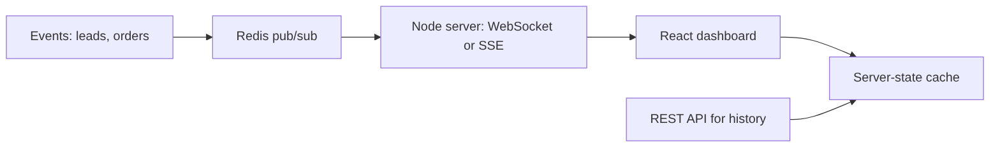

Mermaid source (renders natively on GitHub)

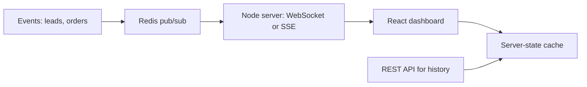

### Theory

1. **How does React reconcile updates, and why do keys matter?**
   React compares the new virtual tree with the previous one. Keys identify list items so React can reorder instead of recreating them. Using array indexes as keys on reorderable lists causes wrong state reuse and extra DOM work.
2. **When does a component re-render?**
   When its state or props change, when its parent re-renders (unless memoized), or when a context it consumes changes.
3. **`useMemo` vs `useCallback` vs `React.memo`.**
   `useMemo` caches a computed value, `useCallback` caches a function reference, `React.memo` skips re-render if props are shallow-equal. Use them after measuring, not by default.
4. **Rules of hooks and why they exist.**
   Call hooks only at the top level and only from components or custom hooks, because React tracks hooks by call order.
5. **`useEffect` cleanup and dependency pitfalls.**
   Return a cleanup function for subscriptions and timers. Missing dependencies cause stale closures, and unstable object dependencies cause effect loops.
6. **Controlled vs uncontrolled components.**
   Controlled: React state owns the value. Uncontrolled: the DOM owns it, read through a ref. Forms with validation usually use controlled inputs or a form library.
7. **Context vs Redux vs server-state libraries.**
   Context is for low-frequency values (theme, auth). Redux (or Zustand) suits complex client state. React Query or SWR handles server state (caching, refetching, deduping), which removes much Redux code.
8. **CSR vs SSR vs SSG vs ISR (Next.js).**
   CSR renders in the browser. SSR renders per request. SSG renders at build time. ISR regenerates static pages in the background on a schedule or on demand. Choose by freshness, SEO and cost.
9. **React Server Components.**
   Components that run only on the server, send no JavaScript to the client and can read data directly. Client components are needed for interactivity.
10. **React 18 concurrency: `useTransition`, `Suspense`.**
    Mark non-urgent updates as transitions so typing stays responsive. Suspense shows fallbacks while data or code loads.
11. **Core Web Vitals and how to improve them.**
    LCP (largest content), INP (interaction responsiveness), CLS (layout shift). Fixes: image optimization, code splitting, lazy loading, avoiding layout shifts, reducing main-thread work.
12. **Where do you store auth tokens?**
    Prefer httpOnly, Secure, SameSite cookies for session or refresh tokens to reduce XSS exposure. Keep access tokens short-lived. Avoid localStorage for sensitive tokens.
13. **How do you prevent XSS and CSRF?**
    XSS: escape output, avoid `dangerouslySetInnerHTML`, sanitize HTML, use a Content Security Policy. CSRF: SameSite cookies, CSRF tokens for cookie-based auth.
14. **Error boundaries.**
    Class components (or libraries) that catch render errors in child trees and show a fallback. They do not catch errors in event handlers or async code.
15. **Micro frontends: when and trade-offs.**
    Useful for many independent teams. Costs: shared dependency management, consistent UX, performance, and harder local development.

### Scenarios

1. **The page is slow after a new feature shipped. How do you debug?**
   Profile with React DevTools and Lighthouse, check bundle size, find unnecessary re-renders, check network waterfalls, add code splitting and memoization where measured.
2. **Users see stale data after an update.**
   Check cache headers, CDN, service worker, and the server-state cache invalidation (React Query keys). Add explicit invalidation on mutation.
3. **A memory leak is reported in a single-page app.**
   Look for uncleaned listeners, timers, subscriptions and detached DOM; use the Chrome heap snapshot comparison.
4. **A third-party script breaks your layout in production only.**
   Reproduce with the same CSP and ad blockers, isolate with feature flags, load the script after interaction, and monitor with error tracking.

---

## 13. Node.js and NestJS

### System Design

1. **Design a multi-channel notification service (WhatsApp, email, SMS).**
   Hints: API accepts a request, a queue per channel, workers with retries and backoff, idempotency key, provider fallback, templates, delivery status webhooks, rate limits, audit log.
2. **Design a rate limiter for an API gateway.**
   Hints: token bucket or sliding window in Redis, per-tenant and per-route limits, return `429` with `Retry-After`, protect Redis with local fallback.
3. **Design a job scheduler / workflow engine for follow-ups.**
   Hints: durable jobs with delays, retries, idempotency, state per run, replayable history; tools like Trigger.dev, Temporal or Durable Functions.

#### Diagram: NestJS request lifecycle

Mermaid source (renders natively on GitHub)

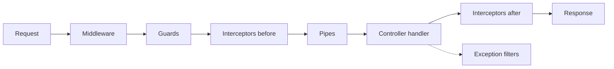

### Theory

1. **Explain the Node.js event loop.**
   Single-threaded loop with phases (timers, pending callbacks, poll, check, close). libuv handles async I/O with a thread pool. CPU-heavy work blocks the loop.
2. **`process.nextTick` vs `Promise` microtasks vs `setImmediate`.**
   `nextTick` runs before promise microtasks, both before the next loop phase. `setImmediate` runs in the check phase.
3. **How do you use multiple CPU cores?**
   `cluster`, a process manager (PM2), containers per core, or `worker_threads` for CPU-bound tasks.
4. **Streams and backpressure.**
   Streams process data in chunks. Backpressure stops the producer when the consumer is slow. Use `pipeline` to handle errors and cleanup.
5. **How do you handle unhandled promise rejections?**
   Always `await` or catch, add a global handler that logs and exits so the process manager restarts, and use structured error classes.
6. **How do you find and fix memory leaks in Node?**
   Heap snapshots and `--inspect`, look at growing closures, caches without limits, listeners not removed.
7. **NestJS: modules, providers, controllers.**
   Modules group related code, providers (services) hold logic and are injected, controllers handle routes.
8. **NestJS request lifecycle order.**
   Middleware, guards, interceptors (before), pipes, handler, interceptors (after), exception filters.
9. **Provider scopes.**
   Default singleton; request-scoped creates one per request (costs performance and bubbles up); transient creates one per consumer.
10. **Guards vs interceptors vs pipes vs filters.**
    Guards: authorization. Interceptors: wrap handler (logging, mapping, caching). Pipes: validation and transformation. Filters: exception handling.
11. **Validation with DTOs.**
    `class-validator` and `class-transformer` with the global `ValidationPipe` (`whitelist`, `forbidNonWhitelisted`, `transform`).
12. **Circular dependencies in Nest.**
    Avoid by redesign (extract shared module); `forwardRef` is the workaround.
13. **NestJS microservices transports.**
    TCP, Redis, NATS, RabbitMQ, Kafka, gRPC. Message pattern (request/response) vs event pattern (fire and forget).
14. **REST vs GraphQL vs gRPC.**
    REST: simple, cacheable. GraphQL: flexible client queries, risk of expensive queries. gRPC: fast, typed, good for service-to-service.
15. **Express vs Fastify under Nest.**
    Fastify is faster with lower overhead; Express has a wider middleware ecosystem.

### Scenarios

1. **The API's p99 latency spikes during peak.**
   Check event-loop lag, slow DB queries, connection pool exhaustion, unbounded Promise.all, GC. Add timeouts, pooling, caching and backpressure.
2. **The process crashes with out-of-memory every few hours.**
   Heap snapshots over time; find unbounded caches, large in-memory arrays, leaked listeners; set limits and restart policy while fixing.
3. **A webhook is delivered twice and creates duplicate records.**
   Idempotency key stored with a unique constraint; return the previous result on replay.
4. **A circular import breaks the Nest app after a refactor.**
   Find the cycle with the error trace, extract shared code into a third module, use `forwardRef` only as a stopgap.

---

## 14. Python and FastAPI

### System Design

1. **Design a document-processing API (PDF, DOCX, XLSX) with async jobs.**
   Hints: upload to object storage, job queue, extractor workers, status endpoint, webhooks, structured output with schema validation, retry and dead-letter queue.
2. **Design a data-scraping and anomaly-detection pipeline.**
   Hints: crawl scheduler, rate limits, parsing, validation, storage, anomaly model in a separate worker, alerting, export, Swagger-documented API.
3. **Design an LLM gateway service in FastAPI.**
   Hints: one internal API for all LLM calls, auth per tenant, rate limits, retries and fallback models, caching, token and cost logging, prompt version tracking.

#### Diagram: FastAPI async job pattern

Mermaid source (renders natively on GitHub)

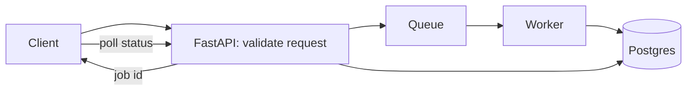

### Theory

1. **What is the GIL and how does it affect you?**
   Only one thread runs Python bytecode at a time. Threads help I/O-bound work; use multiprocessing or native libraries for CPU-bound work.
2. **`async def` vs `def` endpoints in FastAPI.**
   `async def` runs on the event loop and must not block. Plain `def` endpoints run in a thread pool, so blocking calls are safer there.
3. **What blocks the event loop and how do you fix it?**
   Sync DB drivers, `requests`, CPU loops. Use async clients (`httpx`, async SQLAlchemy), `run_in_threadpool`, or workers.
4. **Pydantic v2: validation and serialization.**
   Type-driven models, `Field` constraints, validators, `model_dump`, strict vs lax mode, `BaseSettings` for configuration.
5. **FastAPI dependency injection.**
   `Depends` provides DB sessions, auth, settings; dependencies can be cached per request, overridden in tests.
6. **`BackgroundTasks` vs Celery/RQ/queues.**
   `BackgroundTasks` runs after the response in the same process (no durability). Use a queue for retries, persistence and scaling.
7. **Lifespan events and app startup.**
   Use `lifespan` to create and close shared resources (DB pool, HTTP client, model clients).
8. **Running in production.**
   Gunicorn with Uvicorn workers or multiple containers; set worker count by CPU; health endpoints; graceful shutdown.
9. **Generators, decorators, context managers.**
   Generators stream data lazily; decorators wrap functions; context managers manage setup and cleanup (`with`).
10. **Type hints and static checking.**
    `mypy` or `pyright`, `Protocol`, `TypedDict`, generics for maintainable code.
11. **Testing FastAPI.**
    `pytest`, `httpx.AsyncClient`, dependency overrides, fixtures for DB, factory data, tolerance-based assertions for LLM output.
12. **SQLAlchemy N+1 and how to avoid it.**
    Use `selectinload` or `joinedload`; check query counts in tests.
13. **`asyncio.gather` vs sequential awaits.**
    `gather` runs awaitables concurrently; limit concurrency with a semaphore to avoid overload.
14. **Python memory and performance basics.**
    Profile first (`cProfile`, `py-spy`), use generators, avoid copying large data, vectorize with Pandas or NumPy where suitable.

### Scenarios

1. **The FastAPI service freezes under load.**
   Find blocking calls inside `async def`, check thread pool size, DB pool exhaustion, add timeouts and observability.
2. **An LLM call returns invalid JSON 3% of the time.**
   Use structured output mode, Pydantic validation, retry with error feedback, fallback, and track failure rate.
3. **Tests are flaky because an LLM output varies.**
   Mock the model for unit tests; use tolerance-based assertions and a golden set for integration evaluations.
4. **A deployment doubled memory usage.**
   Compare dependency changes, check model or cache loading per worker, reduce workers or share memory, profile.

---

## 15. Quick revision checklist

- [ ] I can explain one project end to end: problem, architecture, my role, hardest challenge, result, what I would change.
- [ ] I can state how every number in my resume was measured.
- [ ] I can explain RAG evaluation with real metrics (recall@k, faithfulness).
- [ ] I can write a FastAPI endpoint with Pydantic and async calls from scratch.
- [ ] I can draw a multi-tenant data model with tenant isolation and cost attribution.
- [ ] I can compare Lambda and containers and say when each fits.
- [ ] I can explain Kubernetes probes, requests and limits, and debug `CrashLoopBackOff`.
- [ ] I can explain MCP vs function calling and list MCP security risks.
- [ ] I can explain the local-to-production path for a RAG prototype on Azure and AWS.
- [ ] I can describe how I would lead a team: reviews, standards, mentoring, AI tool conventions.
- [ ] I have an honest story about a POC or agent that failed, and what I learned.
